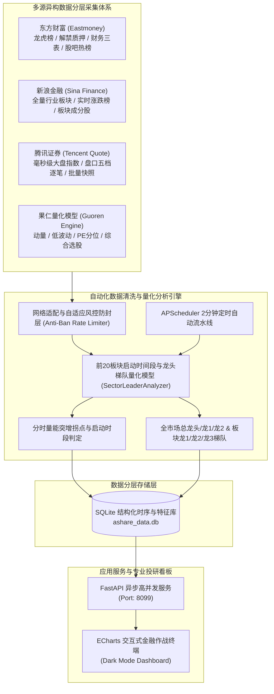

# A 股市场全息信息收集与监控系统架构与操作手册

本系统遵循**“数据分层、按需抓取、兼顾风控与算力”**的设计哲学，已在本地完整构建并运行，专门解决 A 股短线复盘、盘中异动追踪、主线板块轮动分析及多因子量化打分需求。

---

## 一、 系统架构总览



---

## 二、 核心五大收集维度落地对照

| 收集维度 | 实现字段 / 模块 | 落地方式与算法模型 |
| :--- | :--- | :--- |
| **1. 基础量价行情** | 开高低收、涨跌幅、成交额、成交量、换手率、振幅、量比 | 整合腾讯与新浪行情高并发通道，支持批量快照与全量穿透 |
| **2. 资金流向与情绪** | **前20板块深度资料**、**启动时间段**、**全市场总龙头/龙1/龙2**、**板块龙1/龙2/龙3**、**盘中强势板块** | `core/sector_analyzer.py` 基于分时量能拐点推算启动时段；基于封板时间、涨幅、换手与流通盘加权评定龙头梯队 |
| **3. 估值与基本面财务** | PE-TTM、PB、市值、财务指标 | `collectors/eastmoney.py` 与 `sina.py` 动态接入成分股市盈率/市净率与财务数据 |
| **4. 股东行为与事件** | 龙虎榜机构与游资买卖席位、限售股解禁日期与比例、股东人数集中度 | 接入东财数据中心 `RPT_DAILYBILLBOARD_DETAILS` 与 `RPT_LIFT_STAGE` |
| **5. 社区舆情与量化因子** | 股吧热度排行、多空情绪打分、果仁网 20D/60D 动量、低波动率、复合量化得分 | `collectors/sentiment.py` 抓取热度，`core/guoren_quant.py` 动态输出复合多因子选股池 |

---

## 三、 核心算法模型说明

### 1. 板块启动时间段推断算法 (`estimate_launch_period`)
- **算法原理**：板块由领涨龙头先行发动，算法解析龙头股的分时逐分钟成交量序列，检测集合竞价后首个出现**成交量成倍突增的拐点分钟**与分时拉升拐点。
- **输出标签**：
  - 早盘开盘秒板抢筹（09:30 - 09:45）：主力集合竞价溢价抢筹，快速封死涨停板，确立当日主线地位。
  - 早盘放量共振（09:50 - 10:30）：资金承接换手充分，板块内部梯队形成集群效应。
  - 午后资金发酵（13:30 - 14:15）：短线热钱回流低位补涨，带动板块脉冲拉升。

### 2. 龙头梯度量化模型 (`rank_sector_dragons` & `_evaluate_market_leaders`)
- **全市场总龙头（MASTER）**：全市场情绪总旗手，综合涨停溢价、封单强度、换手承接与全市场资金聚焦度最高。
- **全市场龙1（DRAGON_1）**：主线题材核心领涨旗手，率先涨停吸引跟风资金。
- **全市场龙2（DRAGON_2）**：容量中军龙头，高额成交稳固板块做多基石。
- **各板块梯队**：每个板块独立评选 **龙1（先锋）**、**龙2（中军）**、**龙3（助攻）**，并标注判定原因。

---

## 四、 本地与服务器运行方式 (Windows / Linux 双平台)

系统默认运行于 **8099** 端口，支持 Windows 本地双击启动，以及 Linux 服务器一键部署/后台运行/Docker 容器化托管：

- **投研看板访问地址**：[http://127.0.0.1:8099](http://127.0.0.1:8099)（远程访问请将 `127.0.0.1` 替换为实际 IP）
- **API 交互文档 (Swagger UI)**：[http://127.0.0.1:8099/docs](http://127.0.0.1:8099/docs)
- **本地项目路径**：[`E:\Antigravity ex_project\ashare_monitor`](file:///E:/Antigravity%20ex_project/ashare_monitor)

### 🪟 Windows 运行：
- **1. 一键依赖安装**：双击运行 [install_dependencies.bat](file:///E:/Antigravity%20ex_project/ashare_monitor/install_dependencies.bat)（自动创建虚拟环境并由清华镜像源加速安装全部包）
- **2. 一键数据聚合**：双击运行 [aggregate_data.bat](file:///E:/Antigravity%20ex_project/ashare_monitor/aggregate_data.bat)（全市场大盘+Top20板块+启动时段+龙头梯队+龙虎榜+果仁多因子全量采集入库并打印终端报告）
- **3. 一键启动看板**：双击运行 [run.bat](file:///E:/Antigravity%20ex_project/ashare_monitor/run.bat)（启动 FastAPI 服务并自动在浏览器打开看板）

### 🐧 Linux 服务器运行：
- **1. 一键安装依赖**：
  ```bash
  chmod +x install_dependencies.sh run.sh aggregate_data.sh
  ./install_dependencies.sh
  ```
- **2. 启动看板服务**：
  ```bash
  # 前台运行
  ./run.sh

  # 或后台守护运行 (退出终端不中断)
  nohup ./run.sh > monitor.log 2>&1 &
  ```
- **3. 手动执行一次全量数据聚合**：
  ```bash
  ./aggregate_data.sh
  ```
- **4. 生产环境 Systemd 系统服务 (开机自启)**：
  将 [ashare_monitor.service](file:///E:/Antigravity%20ex_project/ashare_monitor/ashare_monitor.service) 复制到 `/etc/systemd/system/` 并启动：
  ```bash
  sudo systemctl daemon-reload
  sudo systemctl enable --now ashare_monitor
  sudo systemctl status ashare_monitor
  ```
- **5. Docker / Docker Compose 一键运行**：
  ```bash
  docker compose up -d
  ```

---

## 五、 最新升级功能说明

1. **板块成分股全量穿透（挖掘后排低位股）**：
   - 每个板块已由原本截断改为**全量分页获取并存储所有股票**（如生物制造全部 155 只股票），包含龙1、龙2、龙3、中梯队活跃股，以及后排跟风与低位补跌/调整股票，方便全景排查后排标的。
2. **全系统任意股票穿透点击：即时分时图 + 多周期K线图（日K / 周K / 月K / 年K）**：
   - 界面上**所有股票名称或代码均支持直接点击**（包括板块列表成分股、全市场总龙头、盘中强势异动股、果仁量化选股池、龙虎榜席位标的）。
   - 弹窗内集成五维专业行情图表：
     - **⚡ 即时分时图**：含分时价格走势、均线、昨收基准虚线与逐分钟成交量。
     - **📊 日K线图**：前复权日级别蜡烛图，含红涨绿跌成交量与缩放滑块。
     - **📅 周K线图**：捕捉中线趋势与主力波段洗盘/突破形态。
     - **🗓️ 月K线图**：大周期中长线牛熊周期与支撑压力研判。
     - **📈 年K线图**：聚合长达 20 年以上的真实年化趋势走势。
3. **多板块历史 PB / PE 综合横向对比看板**：
   - 顶部新增导航项 **“📈 板块历史PB/PE多板块对比”**。
   - 支持从下拉菜单多选并动态添加多个板块（如生物制造、船舶制造、量具行业等）。
   - 在**同一画布叠图对比**历史市盈率（PE-TTM）或市净率（PB）的变动轨迹，计算历史区间最低/最高值与历史百分位，辅助中长线与波段估值安全边际研判。
4. **页首全市场热度与历史情绪走势板块**：
   - 首页第一屏置顶展示全市场综合热度（0~100）、交投活跃度、赚钱效应与基准指数走势。
   - 叠图展示近 45 个交易日的情绪起伏，设有高潮区（80）、平衡线（50）、冰点区（30）三大预警线。
